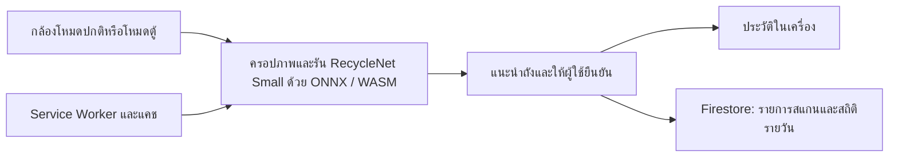

# EcoScan AI - น้องตาวิเศษ: แพลตฟอร์มขยะฮอมบุญ ♻️🇹🇭

เว็บช่วยคัดแยกขยะด้วย RecycleNet MobileNetV3 Small และ ONNX Runtime Web (WebAssembly) ประมวลผลภาพจากกล้องในเบราว์เซอร์

🌐 [Live Demo](https://nongtawiset.web.app)

วางขยะชิ้นเดียวกลางกรอบแล้วกดสแกน ผู้ใช้ยืนยันหนึ่งในสามถังก่อนบันทึก: ทั่วไป รีไซเคิล หรืออันตราย ขวดพลาสติกกับขวดแก้วใช้ถังรีไซเคิลร่วมกัน และยอดขวดพลาสติกเก่านำมารวมในยอดรีไซเคิล หาก AI ไม่แน่ใจ ให้เลือกถังเองหรือสแกนใหม่ ถ่านไฟฉาย แบตเตอรี่ และขยะอันตรายต้องให้ผู้ใช้เลือกถังเอง รูปจากกล้องประมวลผลในเบราว์เซอร์ ระบบส่งเฉพาะข้อมูลการสแกนไป Firestore

- โมเดลจำแนกกระดาษลัง แก้ว โลหะ กระดาษ พลาสติก และขยะทั่วไป ไม่มีตำแหน่งวัตถุหรือหมวดภาพว่าง และไม่แยก PET/HDPE ขยะอันตราย ธนบัตร หรือแบรนด์โดยตรง
- Small ขนาด 6.08 MiB และความแม่นยำ 78.10% เทียบกับ Large ขนาด 16.35 MiB และ 83.11% ตามชุดทดสอบ TrashNet ของผู้เผยแพร่ ตัวเลขยังไม่ผ่านการวัดกับกล้องที่ตู้จริง
- ตัวรัน WebAssembly เพิ่มประมาณ 10.7 MiB ในการโหลดครั้งแรก PWA เก็บโมเดลและตัวรันไว้ใช้เมื่อออฟไลน์หลังแคชสำเร็จ
- ยกเลิกช่องอัปโหลด คลังภาพสอน AI และการเรียนรู้จากภาพแก้คำตอบ ปุ่มแก้คำตอบหลังบันทึกแก้ประวัติและสถิติในเครื่องเท่านั้น ข้อมูลการฝึกเดิมใน Firestore ไม่ถูกลบ และกฎชุดใหม่ปิดการเข้าถึงจากหน้าเว็บ

[โมเดล RecycleNet และ MIT license](https://huggingface.co/LeoYan/recyclenet-mobilenetv3) · [ONNX Runtime Web](https://onnxruntime.ai/docs/tutorials/web/)

## โครงสร้างระบบ



| ส่วน | ไฟล์ที่เกี่ยวข้อง | หน้าที่ |
| --- | --- | --- |
| หน้าเว็บและโหมดตู้ | [index.html](index.html), [styles.css](styles.css), [app.js](app.js) | เปิดกล้อง แสดงกรอบสแกน รับผลจากโมเดล และให้ผู้ใช้ยืนยันถังทั่วไป รีไซเคิล หรืออันตรายก่อนบันทึก |
| การประมวลผลภาพ | [ai-vision.js](ai-vision.js), [โมเดล ONNX](models/recyclenet-small.onnx), [ONNX Runtime Web](vendor/ort/) | เตรียมภาพและทำนายในเบราว์เซอร์ เมื่อความมั่นใจต่ำ ผู้ใช้เลือกถังเองได้ |
| ออฟไลน์และแคช | [sw.js](sw.js), [manifest.webmanifest](manifest.webmanifest) | เปิดหน้าเว็บโดยลองเครือข่ายก่อนและใช้สำเนาที่บันทึกไว้เมื่อจำเป็น ส่วนโมเดลและตัวรัน WASM ใช้ไฟล์ในแคชก่อน |
| ข้อมูลและสถิติ | [app.js](app.js), [firestore.rules](firestore.rules) | บันทึกข้อมูลการสแกนใน `scans` และยอดรายวันรวมกับยอดแยกตู้ใน `stats` ภาพจากกล้องอยู่ในเบราว์เซอร์ |
| เว็บจริงและการตรวจสอบ | [firebase.json](firebase.json), [GitHub Actions](.github/workflows/firebase-deploy.yml), [ชุดทดสอบ](tests/) | ให้บริการผ่าน Firebase Hosting และตรวจการเปิดเว็บกับกฎ Firestore ใน CI |

ตัวตรวจถ่านกระดุมและ OCR สำหรับรหัสอย่าง CR2032 หรือ CR2025 อยู่ระหว่างการทดลองนอกเว็บจริง การเลือกถังอันตรายในเว็บปัจจุบันอาศัยการยืนยันของผู้ใช้

## 🚀 การติดตั้งและรันในเครื่อง (Local Setup)

```bash
# Clone repository
git clone https://github.com/chontipan/nong-ta-wiset.git
cd nong-ta-wiset

# รัน Local Server ด้วย Node.js
node server.js
```

เปิดเบราว์เซอร์ไปที่: `http://localhost:8080`

---

## 🏪 ตั้งค่าตู้ (Kiosk)

- **ตั้งชื่อตู้**: เปิดลิงก์ `https://nongtawiset.web.app/?kiosk=ตลาดแม่จัน` ครั้งเดียว เครื่องจะจำชื่อไว้ ทุกการสแกนจะบันทึกชื่อตู้ไปด้วย
- **สถิติรายวัน** ใน Firestore: `stats/2026-10-30` (รวมทุกตู้) และ `stats/2026-10-30__ตลาดแม่จัน` (แยกตู้)
- **ตู้ดูแลตัวเอง**: กล้องหลุดจะเชื่อมต่อใหม่เอง, รีเฟรชหน้าเองตอนตี 3 เมื่อไม่มีคนใช้ (กลับเข้าโหมดตู้ให้เอง), โหลด AI ไม่ได้จะลองใหม่ทุก 1 นาที

---

## 🧪 การทดสอบ

```bash
npm install
npm run test:rules   # ทดสอบกฎ Firestore ด้วย emulator (ต้องมี Java)
npm run test:smoke   # เปิดหน้าเว็บจริงด้วยกล้องจำลอง ไม่เขียนข้อมูลลงฐานข้อมูลจริง
```

GitHub Actions รันทั้งสองชุดทุก PR และทุก push ถ้าไม่ผ่านจะไม่ deploy ขึ้นเว็บจริง และทุก PR จะได้ลิงก์ทดลอง (preview) อายุ 7 วันในคอมเมนต์

---

## 📦 การ Deploy ขึ้น Firebase Hosting

```bash
# Deploy to Production
npx -y firebase-tools deploy --only hosting --project waste-5b576
```
